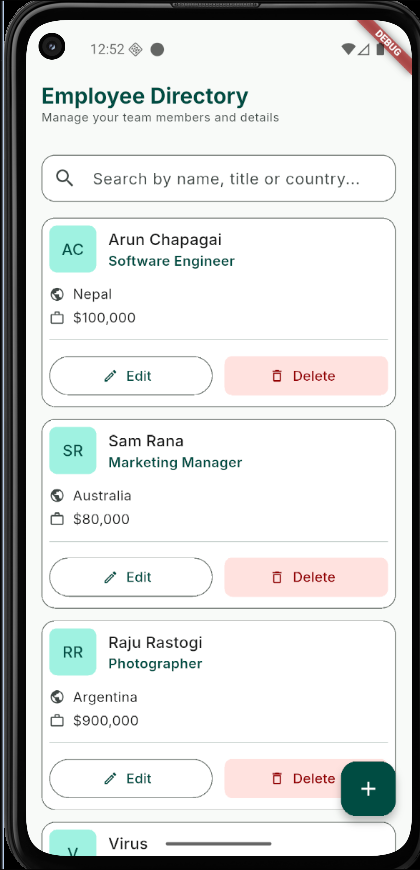
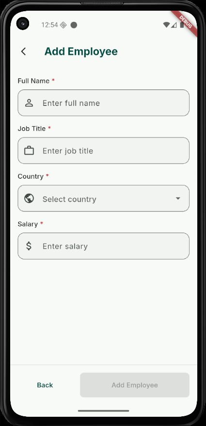
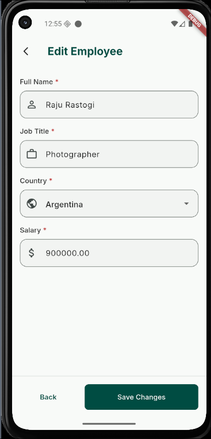
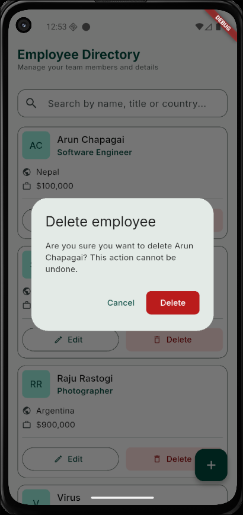
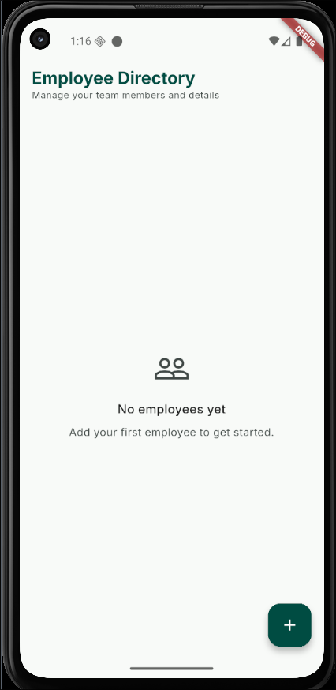
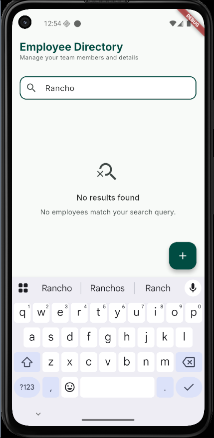
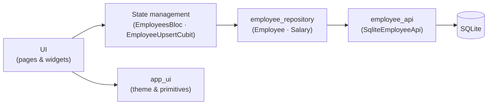

<div align="center">

# Staffly: Flutter Employee Management App (SQLite, Bloc, TDD)

**A production-grade Employee CRUD app built with Flutter, SQLite and Bloc, developed with strict test-driven development.**

[](https://flutter.dev)
[](https://dart.dev)
[](https://bloclibrary.dev)
[](https://pub.dev/packages/sqflite)
[](https://pub.dev/packages/very_good_analysis)
[](#testing)
[](./staffly/LICENSE)

[Features](#features) · [Screenshots](#screenshots) · [Quick start](#quick-start) · [Architecture](#architecture) · [Testing](#testing) · [Implementation details](#implementation-details)

</div>

---

## About

**Staffly** is a Flutter app for managing employee records. It stores each employee's **full name, job title, country and salary** in a local **SQLite** database, and supports create, read, update and delete.

It is built to production standards rather than as a demo:

- **Strict TDD.** Every behaviour started as a failing test. The commit history shows the red → green → refactor loop as separate commits.
- **Layered architecture.** Data → Repository → State management → UI, built in that order, with the boundaries enforced by package dependencies.
- **Money handled correctly.** Salaries are stored as integer minor units (paisa), never as `double`.
- **100% test coverage**, enforced in CI by [Very Good Workflows](https://github.com/VeryGoodOpenSource/very_good_workflows).

## Features

- 📋 **Employee list:** cards showing each employee's name, job title, country and formatted salary
- 🔍 **Instant search:** filter by name, job title or country as you type
- ➕ **Add employee:** a modal form with field-level validation
- ✏️ **Edit employee:** the form is pre-filled, and the route (`/upsert/:employeeId`) works as a deep link
- 🗑️ **Delete employee:** asks for confirmation before deleting
- 💾 **Offline persistence:** all records are saved to SQLite on the device
- 🌐 **Localized strings:** all UI text comes from ARB files via `flutter_localizations`
- 🧪 **Three flavors:** development, staging and production

## Screenshots

<table>
  <tr>
    <td align="center"><br/><sub><b>Employee list</b></sub></td>
    <td align="center"><br/><sub><b>Add employee</b></sub></td>
    <td align="center"><br/><sub><b>Edit employee</b></sub></td>
  </tr>
  <tr>
    <td align="center"><br/><sub><b>Delete confirmation</b></sub></td>
    <td align="center"><br/><sub><b>Empty state</b></sub></td>
    <td align="center"><br/><sub><b>No search results</b></sub></td>
  </tr>
</table>

## Tech stack

| Concern | Choice |
| --- | --- |
| Framework | [Flutter](https://flutter.dev) 3.44 · Dart 3.12 |
| State management | [`bloc`](https://pub.dev/packages/bloc) / [`flutter_bloc`](https://pub.dev/packages/flutter_bloc) |
| Local database | [`sqflite`](https://pub.dev/packages/sqflite) (SQLite) |
| Routing | [`go_router`](https://pub.dev/packages/go_router) |
| Form validation | [`formz`](https://pub.dev/packages/formz) |
| Value equality | [`equatable`](https://pub.dev/packages/equatable) |
| Testing | `flutter_test`, [`bloc_test`](https://pub.dev/packages/bloc_test), [`mocktail`](https://pub.dev/packages/mocktail), `sqflite_common_ffi` |
| Linting | [`very_good_analysis`](https://pub.dev/packages/very_good_analysis), [`bloc_lint`](https://pub.dev/packages/bloc_lint) |
| Scaffolding & CI | [Very Good CLI](https://cli.vgv.dev), [Very Good Workflows](https://github.com/VeryGoodOpenSource/very_good_workflows) |

## Quick start

### Prerequisites

- Flutter SDK `^3.44.0` (Dart `^3.12.0`)
- An Android emulator, iOS simulator or physical device
- Optional: [Very Good CLI](https://cli.vgv.dev) (`dart pub global activate very_good_cli`)

### Run the app

```sh
git clone https://github.com/ArunChapagain/flutter-kata.git
cd flutter-kata/staffly
flutter pub get
flutter run --flavor development --target lib/main_development.dart
```

Other flavors:

```sh
flutter run --flavor staging    --target lib/main_staging.dart
flutter run --flavor production --target lib/main_production.dart
```

For git hooks, translations and other developer setup, see [`staffly/README.md`](./staffly/README.md).

## Architecture

Four layers, grouped into the classic data and presentation halves:

```
staffly/
├── packages/
│   ├── employee_api/            [Dart-only]   Data layer
│   │   └── EmployeeApi (abstract) · SqliteEmployeeApi · EmployeeRecord
│   ├── employee_repository/     [Dart-only]   Repository layer
│   │   └── EmployeeRepository · Employee · Salary
│   └── app_ui/                  [Flutter]     Design system
│       └── AppTheme · AppSpacing · AppColors · shared primitives
└── lib/
    ├── employees/
    │   ├── bloc/                              List state: EmployeesBloc
    │   ├── cubit/                             Form state: EmployeeUpsertCubit
    │   ├── models/                            formz inputs (FullName, JobTitle, …)
    │   ├── view/                              Presentation layer
    │   └── widgets/                           EmployeeCard, upsert form
    └── app/ · bootstrap.dart · main_*.dart    Composition root
```

Dependency direction is enforced by `pubspec.yaml`, not by convention:

```
lib/employees/view  →  lib/employees/bloc  →  employee_repository  →  employee_api
                    ↘  app_ui
```



## Testing

Each package is tested on its own. The data layer runs against a real SQLite database through `sqflite_common_ffi`, so the database tests run under plain `dart test` without a device.

```sh
# Everything, recursively, with coverage
cd staffly
very_good test --recursive --coverage --test-randomize-ordering-seed random

# A single package
cd staffly/packages/employee_api && dart test

# Static analysis and formatting
cd staffly
dart analyze --fatal-infos
dart format --set-exit-if-changed .
```

CI ([`.github/workflows/main.yaml`](./.github/workflows/main.yaml)) runs analysis, `bloc_lint`, the tests with a 100% coverage threshold for the app and every package, a spell check on the Markdown files, and a license check on dependencies.

### Following the TDD history

The git log records each cycle as separate commits:

```sh
git log --oneline --reverse
```

- `test(<scope>): …` is a **red** commit that adds failing tests
- `feat(<scope>): …` is the **green** commit that makes them pass
- `refactor(<scope>): …` is a cleanup commit, made only while the tests are green

## Implementation Details

### Database search and pagination
Due to time constraints, database search and pagination have not been implemented. Implementing them at the database and API level would be best for scaling and performance.

### Dependency injection: constructor injection, no `get_it`/`injectable`
Constructor injection everywhere; `MultiRepositoryProvider` to expose repositories to the widget tree. This allows testing with real SQLite via `sqflite_common_ffi` simply by injecting a different `DatabaseFactory`.

### Models: `Equatable` + hand-written `copyWith`, no `freezed`
Hand-written value objects extending `Equatable`. Keeps code size small and the red/green TDD loop clean without generated code overhead.

### Salary: integer minor units, never `double`
Persisted as `INTEGER` paisa; modelled as a `Salary` value object; parsed and formatted at the domain boundary. `Salary` owns both directions (rupees string in, grouped string out, always-2dp string for editing out, integer for storage out). No floating point arithmetic is used to avoid precision defects.

### Two models across the layer boundary
`EmployeeRecord` (data layer, storage shape) and `Employee` (domain shape), with a tested mapper between them.

### `EmployeeApi` abstract class in the same package as its implementation
`employee_api` exports both the `EmployeeApi` interface and `SqliteEmployeeApi`.

### `app_ui` stays domain-agnostic
`app_ui` contains only generic primitives. Domain-specific widgets like `EmployeeCard` live in `lib/employees/widgets/`.

### IDs: UUID v4 from an injected generator
`String id`, generated in `EmployeeRepository` via an injected generator defaulting to `const Uuid().v4`.

### Form validation: `formz`
Each form field is a `FormzInput` subclass; `EmployeeUpsertState` mixes in `FormzMixin`. This allows for pure unit tests for validation logic.

### Writes go through the form cubit; the list refetches
`EmployeeUpsertCubit` performs create and update against the repository. On success the view pops the modal and the list dispatches `EmployeesFetchRequested`. Delete stays on `EmployeesBloc`.

### Deeplink-safe routing
To ensure the app is deeplinkable, routes do not require passing full objects via the router's `extra` state. The edit screen (`/upsert/:employeeId`) accepts an ID and relies on `FetchEmployeeBloc` to load the `Employee` model from storage before seeding the form cubit.

### Error handling: typed sealed exceptions, no `Result`/`Either`
Expected failures return (`Salary?`, formz validation errors); exceptional failures throw typed exceptions from a `sealed` base.

## AI usage

Where and how AI was used on this project — tools, prompts, and rationale — is logged incrementally in [`docs/ai-usage.md`](./docs/ai-usage.md).

## License

Released under the [MIT License](./staffly/LICENSE).

---

<div align="center">
<sub>Built with Flutter · SQLite · Bloc · strict TDD</sub>
</div>
